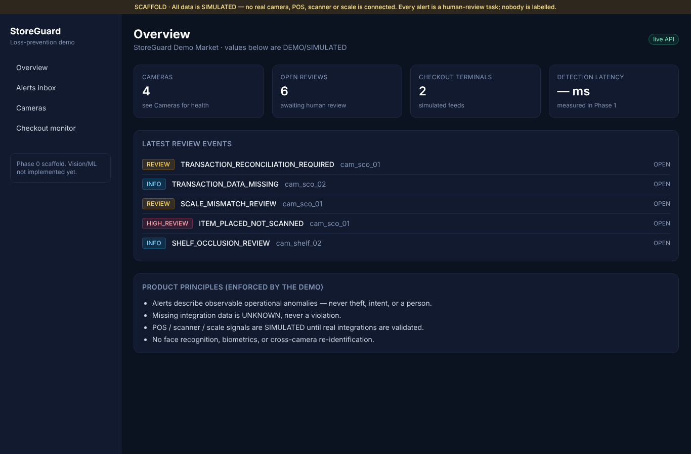
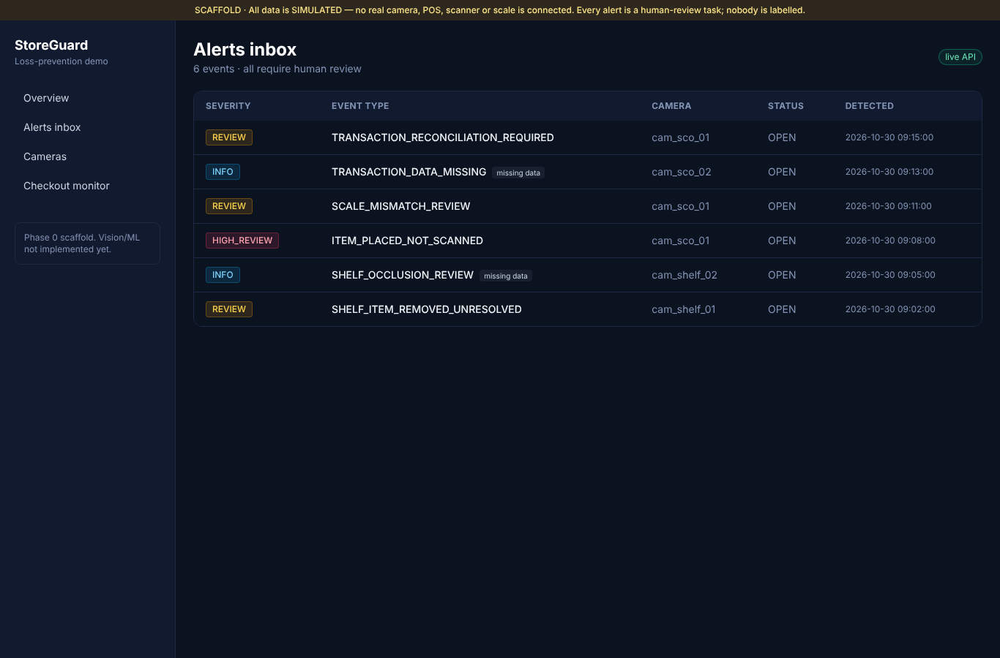
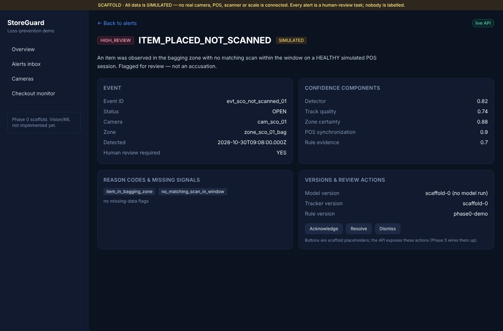
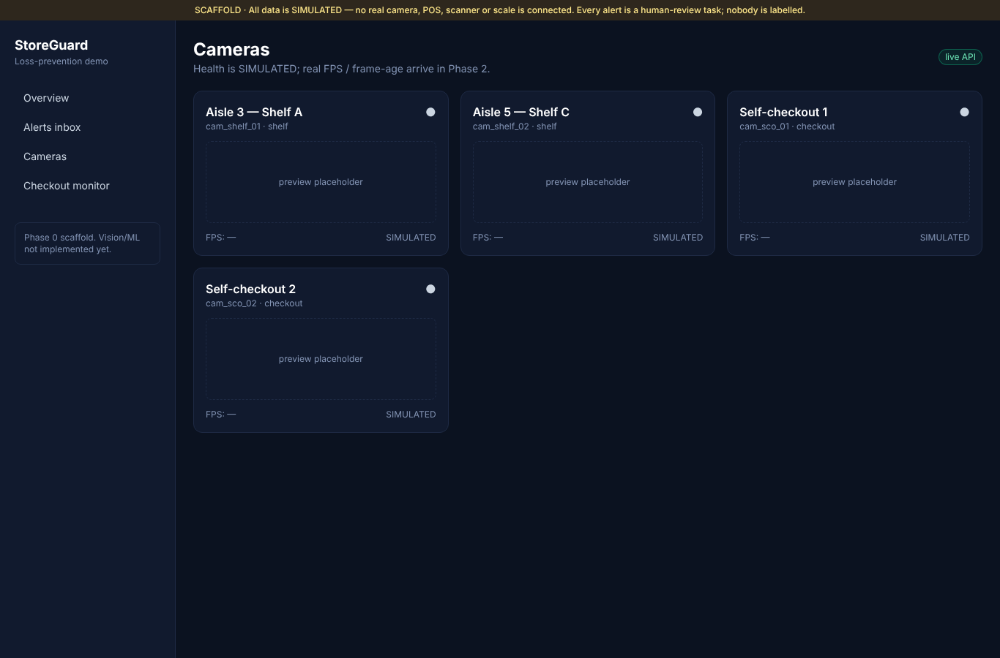
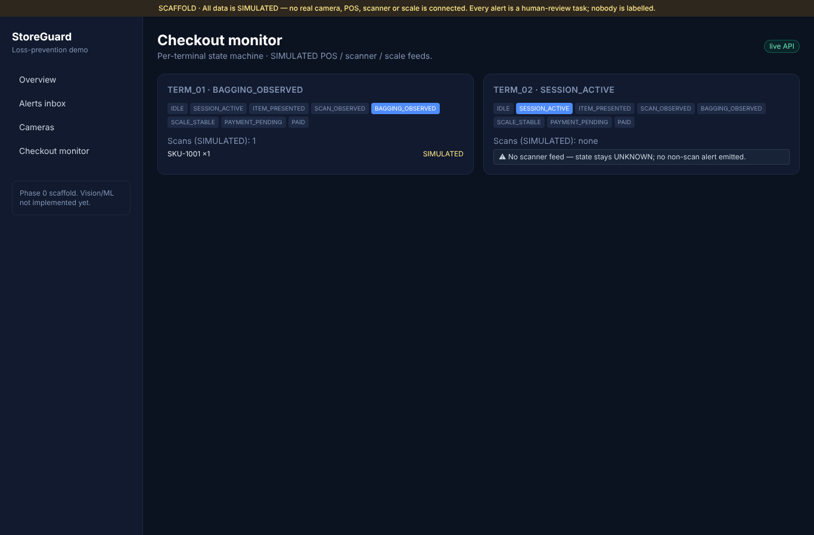
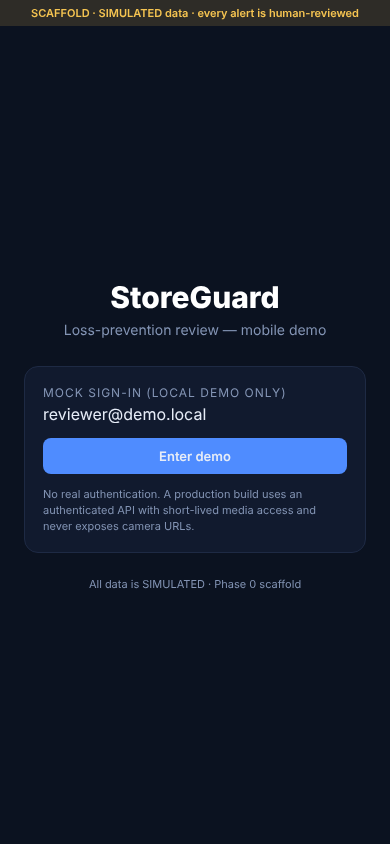
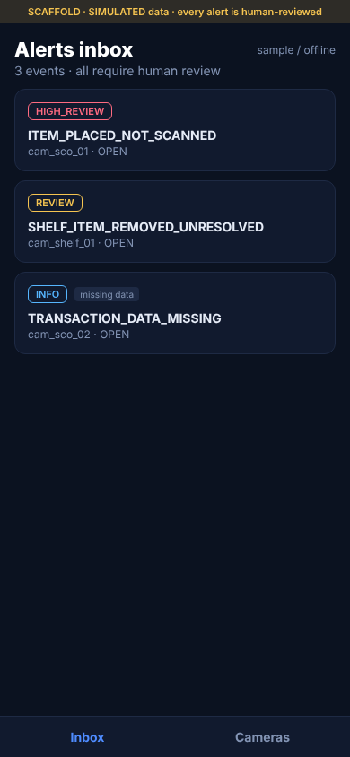
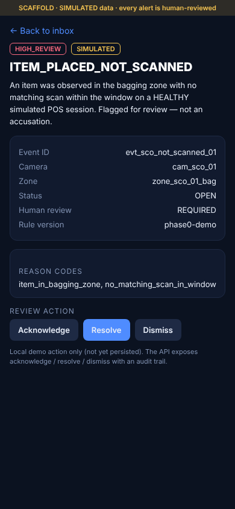
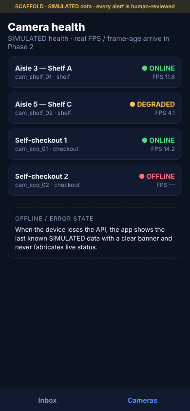

# StoreGuard — Phase 0 Report

> Repository and engineering baseline. **Phase 0 only.** No vision/ML runs and
> no model weights are downloaded. All camera / POS / scanner / scale data is
> **SIMULATED** and labelled as such. Awaiting product-owner review before
> Phase 1.

- **Branch:** `feat/storeguard-demo-foundation`
- **Phase 0 foundation commit:** `0574a193c1cc45ad2251de0b0e90c51eb782f376`
  (this line was recorded in the immediately following commit)
- **Date:** 2026-10-30
- **Toolchain used:** Python 3.13.17 (project targets `>=3.11`), Node v22.22.0,
  Docker 29.x, Chromium/Playwright (screenshots).

## 1. Repository inspection (starting state)
The repository contained only documentation and license before this work:

```
README.md
LICENSE                     (MIT, © 2026 Özgür Işık Damar)
docs/STOREGUARD_DEMO_ROADMAP.md
docs/CLAUDE_IMPLEMENTATION_PROMPT.md
```

`git status` was clean. `main` and the feature branch exist on `origin`. No
application code, tests, or CI existed. Work was done on
`feat/storeguard-demo-foundation`, branched from `origin/main`; `main` was not
modified.

## 2. What was built (Phase 0 scope)

| Area | Path | Summary |
|---|---|---|
| Shared contracts | `packages/contracts` | Pydantic v2 models (source of truth) + hand-mirrored TS types. Core entities + anomaly event contract. |
| Backend | `apps/api` | FastAPI: `/api/v1/health` + seeded **SIMULATED** read endpoints (stores, cameras, events, checkouts) and review actions (acknowledge/resolve/dismiss) + demo scenarios. |
| Persistence | `apps/api/.../db`, `infra/migrations` | SQLAlchemy models + initial Alembic migration mirroring core entities. **Inert in Phase 0** — API/tests run from in-memory seed, no DB required. |
| Web dashboard | `apps/web` | Next.js + TS + Tailwind. Overview, Alerts inbox, Event detail, Cameras, Checkout monitor. SIMULATED banner. |
| Mobile app | `apps/mobile` | Expo + React Native + TS. Mock login, Alert inbox, Event detail + review actions, Camera health, offline note. Web-render capable. |
| Simulated integrations | `services/integrations` | Deterministic POS/scanner/scale generators; every signal `simulated=True`. |
| Vision benchmark | `services/vision` | CPU-first methodology + YOLO26n/YOLO11n plan + harness **stub** (raises `NotImplementedError`; no model run, no weights). |
| Infra / config | `docker-compose.yml`, `infra/docker`, `configs/*.example.yaml`, `.env.example`, `Makefile` | Compose (api+web+postgres), Dockerfiles, example camera/zone/rule configs, dev commands. |
| CI | `.github/workflows/ci.yml` | api (ruff/black/mypy/pytest + alembic offline), web (lint/tsc/build), mobile (tsc/web-export). |
| Docs | `docs/ARCHITECTURE.md`, `docs/ADR/0001–0004` | Architecture + ADRs: modular-monolith-first, CPU-first, model benchmark strategy, simulated-POS boundary. |

## 3. Architecture decisions (and rejected alternatives)
See ADRs for full detail:
- **0001 Modular monolith first** — FastAPI + separated packages; no
  microservices/Kafka/Kubernetes in the MVP. *Rejected:* microservices + bus now
  (unjustified overhead); one undivided app (harder to extract later).
- **0002 CPU-first inference** — bounded latest-frame queue, sampling/ROI,
  OpenVINO/ONNX candidates; no FPS promises before measurement. *Rejected:*
  GPU/DeepStream now; assuming a frame rate.
- **0003 Model benchmark strategy** — YOLO26n is the initial candidate, measured
  against YOLO11n (+ export) on the target CPU; ByteTrack baseline vs
  BoT-SORT/TrackTrack. *Rejected:* hardcoding a winner; a black-box theft
  classifier.
- **0004 Simulated POS boundary** — all POS/scale behind `services/integrations`
  simulators, `simulated=True`, UI-labelled; missing feed →
  `TRANSACTION_DATA_MISSING`/`UNKNOWN`, never a non-scan alert. *Rejected:*
  faking a real integration; inferring non-payment from video alone.

## 4. Product-rule enforcement (evidence in code)
- Neutral, observable event types only — no type names a person. Guarded by
  `apps/api/tests/test_contracts.py::test_no_event_type_names_a_person` and
  `test_events.py::test_no_event_asserts_theft`.
- `human_review_required=True` default on every event
  (`test_event_defaults_require_human_review`).
- Missing-data rule: the seed includes `TRANSACTION_DATA_MISSING` (SCO 2,
  scanner feed unavailable + camera OFFLINE) proving missing data → UNKNOWN, not
  a violation (`test_missing_data_event_is_unknown_not_violation`). The
  checkout monitor shows a terminal with no scanner feed staying UNKNOWN.
- Every integration signal flagged `simulated` (`test_checkouts.py`,
  `services/integrations/tests`).
- No face/biometric/identity fields anywhere in the contracts or DB models.

## 5. Setup / run commands
```bash
make setup            # venv + editable install (contracts, integrations, vision, api)
make test             # backend tests (no database required)
make lint typecheck   # ruff/next-lint + mypy/tsc
make dev-api          # http://localhost:8000  (OpenAPI at /docs)
make setup-web  && make dev-web          # http://localhost:3000
make setup-mobile && make export-mobile-web   # static Expo web build
docker compose up --build                # api + web + postgres
```

## 6. Verification — actual command output
All commands run on 2026-10-30 in this environment.

**Backend — pytest**
```
24 passed, 1 warning in 0.34s
```
(one warning: Starlette TestClient httpx deprecation — cosmetic.)

**Backend — ruff**
```
All checks passed!
```

**Backend — black --check**
```
32 files would be left unchanged.
```

**Backend — mypy**
```
Success: no issues found in 25 source files
```

**Backend — health smoke (uvicorn + curl)**
```
GET /api/v1/health → 200
{"status":"ok","service":"storeguard-api","version":"0.1.0","phase":"phase-0","simulated_data":true, ...}
```

**Alembic — offline migration SQL (no DB needed)**
```
CREATE TABLE stores (...); CREATE TABLE cameras (...); CREATE TABLE camera_zones (...);
CREATE TABLE anomaly_events (...); CREATE TABLE checkout_sessions (...); CREATE TABLE audit_logs (...);
```

**Web — typecheck / lint / build**
```
tsc --noEmit            → (no errors)
next lint               → ✔ No ESLint warnings or errors
next build              → ✓ Compiled successfully; 7 routes generated
```

**Mobile — typecheck / web export**
```
tsc --noEmit            → (no errors)
expo export --platform web → Web Bundled (202 modules); Exported: dist
```

**Docker compose**
```
docker compose config → compose config OK
```

## 7. Screenshots
Captured with Playwright/Chromium against the running API + web build, and the
Expo **web** export served statically (phone viewport). The mobile app shows a
"sample / offline" pill because the static host origin is not in the API CORS
allow-list — identical SIMULATED content, honestly labelled.

### Web dashboard






### Mobile (Expo web render, phone viewport)





## 8. Known gaps and risks
- **No vision/ML yet** — `services/vision` is a stub; YOLO26n/YOLO11n benchmark
  and detection/tracking are Phase 1. No weights downloaded.
- **No real integrations** — POS/scanner/scale are simulated; no real RTSP,
  camera, or transaction source.
- **DB inert** — endpoints serve the in-memory seed; the SQLAlchemy/Alembic path
  is defined but not wired into the request path or exercised against a live
  Postgres yet.
- **TS contracts are a hand mirror** of the Pydantic source of truth; a
  generator is a Phase 7 item. A drift check is manual for now.
- **Review action buttons** in the web UI are placeholders (the API endpoints
  exist); wiring is Phase 5. Mobile actions update local state only.
- **Dependency advisories:** `npm install` reported transitive advisories in the
  web and Expo toolchains (Next pinned to a patched `14.2.35`; Expo toolchain
  reported low/high transitive items). To be reviewed during Phase 7 hardening;
  none affect the Phase 0 scaffold behavior.
- **Python 3.13** was used locally though the project targets `>=3.11` and CI
  runs 3.12; all checks pass on 3.13.

## 9. Status
Phase 0 complete per the roadmap acceptance ("clean clone installs; health
endpoints and baseline tests pass"). No models were run; simulated data is
clearly labelled throughout. **Stopping here and awaiting product-owner review
before Phase 1.**
