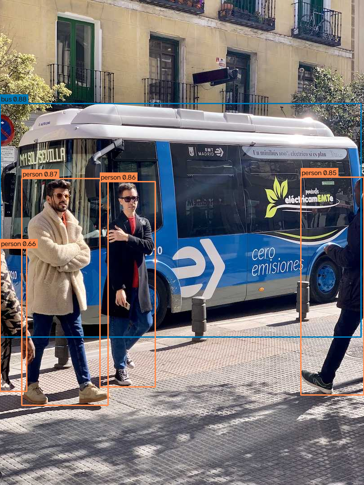
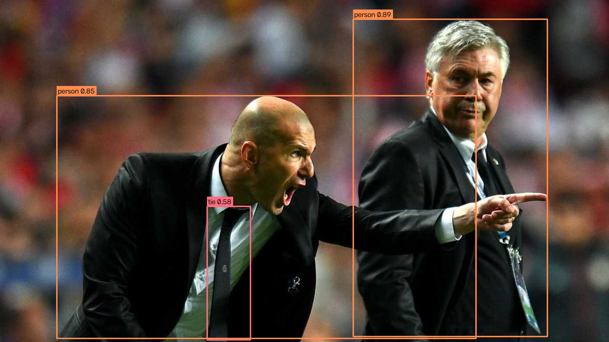
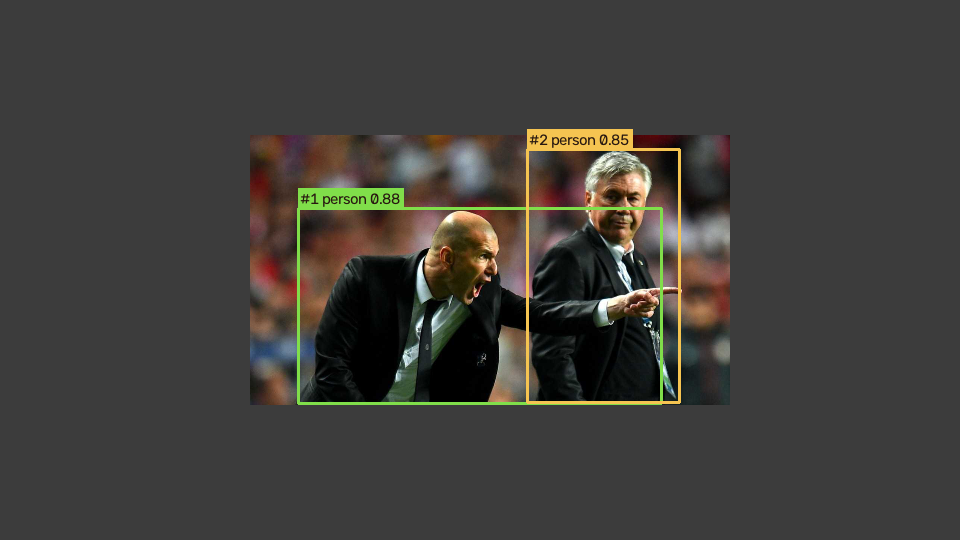

# StoreGuard — Phase 1 Report

> Offline vision workbench. Phase 1 runs **real models on CPU** and reports
> **measured** numbers only. Nothing here is invented; quality metrics that need
> a labelled eval set are explicitly left unmeasured. Awaiting product-owner
> review before Phase 2.

- **Branch:** `feat/storeguard-demo-foundation`
- **Phase 1 commit:** `__PHASE1_SHA__`
- **Date:** 2026-10-30
- **Machine:** 4× Intel(R) Xeon(R) @ 2.10GHz, CPU-only.
- **Stack:** ultralytics 8.4.193, torch 2.15.0+cu132 (run on CPU), OpenCV 5.0.0,
  Python 3.13.17.

## 1. Model availability (verified, not assumed)
The roadmap requires verifying package/model availability at implementation
time. In this environment, with `ultralytics==8.4.193`, **both candidates load
and download successfully** from the official assets:

```
OK   yolo11n.pt: loaded; task=detect; names=80 classes
OK   yolo26n.pt: loaded; task=detect; names=80 classes
```

So the YOLO26n vs YOLO11n comparison is real — no substitute was needed.

## 2. What was built
- **Capture adapters** (`services/vision/.../capture/`): `SyntheticFrameSource`
  (numpy, no deps — moving blobs for pipeline/latency/tracking), `FileFrameSource`
  (OpenCV video or image directory).
- **Detector/tracker** (`detect/detector.py`): `YoloDetector` wrapping ultralytics,
  CPU-first, `infer()` (detect) and `track()` (ByteTrack, persistent per-source
  state). Exposes only class/box/score + ephemeral track id — no identity.
- **Annotation** (`annotate.py`): boxes, labels, scores, track ids.
- **Benchmark harness** (`benchmark.py`): real `run_benchmark()` measuring
  latency p50/p95/mean, single-stream FPS, process CPU% and peak RSS, with warmup.
- **CLI** (`cli.py`): `benchmark`, `annotate`, `track`.
- **Tests**: pure-python metric/capture tests + a guarded ML smoke test that runs
  a tiny real inference locally and **skips** where the `ml` extra is absent (so
  CI stays fast). Full suite: **33 passed**.

The Phase 0 harness stub is now implemented; export candidates
(`onnx-export`, `openvino-export`) raise a clear `NotImplementedError` pending a
follow-up (documented below).

## 3. How to run
```bash
pip install -e "services/vision[ml]"
python -m storeguard_vision.cli benchmark --models yolo26n yolo11n --clip .cache/samples --frames 48 --out runs
python -m storeguard_vision.cli annotate  --model yolo26n --clip .cache/samples --max 2 --out runs
python -m storeguard_vision.cli track     --model yolo26n --image .cache/samples/zidane.jpg --out runs
```
Sample images are ultralytics' bundled `bus.jpg` / `zidane.jpg` (generic public
images used only to exercise the COCO detector). Weights download on first use;
weights and `runs/` are git-ignored.

## 4. Benchmark results (measured on this CPU)
48 frames, input size 640, CPU, ByteTrack baseline, over the sample images:

| Model | imgsz | frames | p50 ms | p95 ms | mean ms | FPS | CPU % | peak RSS MB | detections |
|---|---|---|---|---|---|---|---|---|---|
| **yolo26n** | 640 | 48 | **46.26** | 64.08 | 49.26 | **20.3** | 267.0 | 1109.0 | 192 |
| yolo11n | 640 | 48 | 52.88 | 64.41 | 53.13 | 18.82 | 273.1 | 1118.1 | 192 |

`CPU %` is process-wide across 4 cores (so >100%). Both models returned the same
192 total detections over the identical frame set. Raw output:
`services/vision/runs/benchmark.json` / `benchmark.md`.

### Reading the result
On this 4-core CPU, **YOLO26n was slightly faster** than YOLO11n (p50 46.3 ms vs
52.9 ms; 20.3 vs 18.8 FPS) at equal detection count and comparable memory. This
is a **single run on one machine over two images** — enough to show the harness
and that YOLO26n is at least competitive here, **not** enough to declare a
production winner. A fuller decision needs more frames, representative retail
clips, and the quality metrics below.

## 5. Detection & tracking outputs
### Detections (YOLO26n)



### Tracking — persistent IDs (YOLO26n + ByteTrack)
A sample image is slid across a canvas to create motion; ByteTrack holds stable
ids across the sequence. Distinct track ids seen over 24 frames: **[1, 2]**.



## 6. What was NOT measured (and why)
- **Precision / recall per class and camera angle** — requires a lawful, labelled
  retail eval set split by store/camera/time. Not available; reported as `None`,
  never estimated.
- **Tracking ID switches / fragmentation** — needs annotated sequences; the demo
  only shows qualitative id persistence.
- **Frame age / dropped frames / reconnect** — these are streaming (RTSP) metrics
  for Phase 2; the offline workbench reports per-frame inference latency instead.
- **OpenVINO / ONNX export candidates** — enumerated and wired into the harness
  interface but not yet benchmarked (follow-up).
- **Supermarket SKU recognition** — COCO weights detect generic classes
  (person, bus, …), not store SKUs. A custom product detector/embedding path on a
  lawful dataset is a separate effort, as noted in ADR 0003.

## 7. Risks / notes
- torch installed is a CUDA build (`2.15.0+cu132`) run on CPU; a CPU-only wheel
  would be smaller. Functionally correct for CPU inference.
- The `ml` extra (ultralytics + CPU torch) is heavy and intentionally excluded
  from the default install and CI; CI runs only the lightweight vision tests.
- Benchmark numbers are environment-specific; re-run on the target hardware.
- Sample images contain recognizable public figures; the system detects a generic
  `person` with a pseudonymous track id and performs **no** identification — the
  images are only inputs to exercise the detector.

## 8. Verification (actual)
```
ruff   → All checks passed!
black  → 43 files left unchanged
mypy   → Success: no issues found in 34 source files
pytest → 33 passed, 1 warning        (24 Phase 0 + 9 vision; ML smoke test ran locally)
benchmark → services/vision/runs/benchmark.{json,md} written with the table above
```

## 9. Status
Phase 1 acceptance met: a reproducible CPU benchmark on this machine, with the
model comparison supported by measurements (not assumptions), plus annotated
detection and persistent-id tracking outputs. **Stopping here and awaiting
product-owner review before Phase 2** (camera + zones / RTSP reconnect & health).
