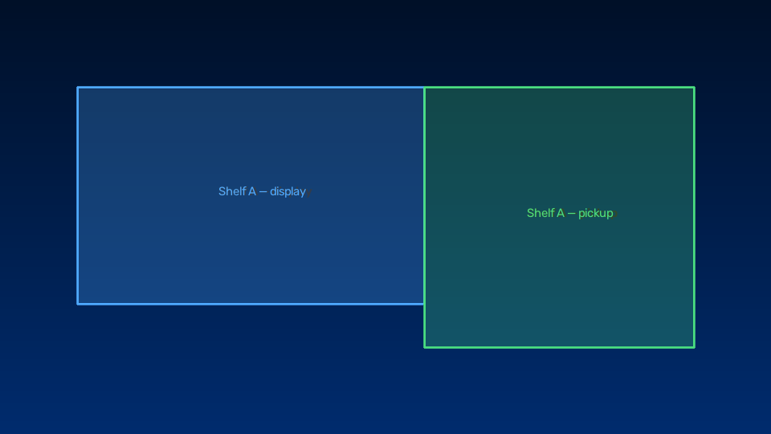
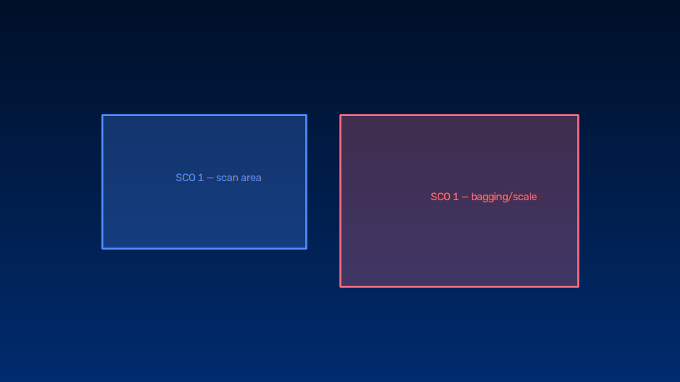
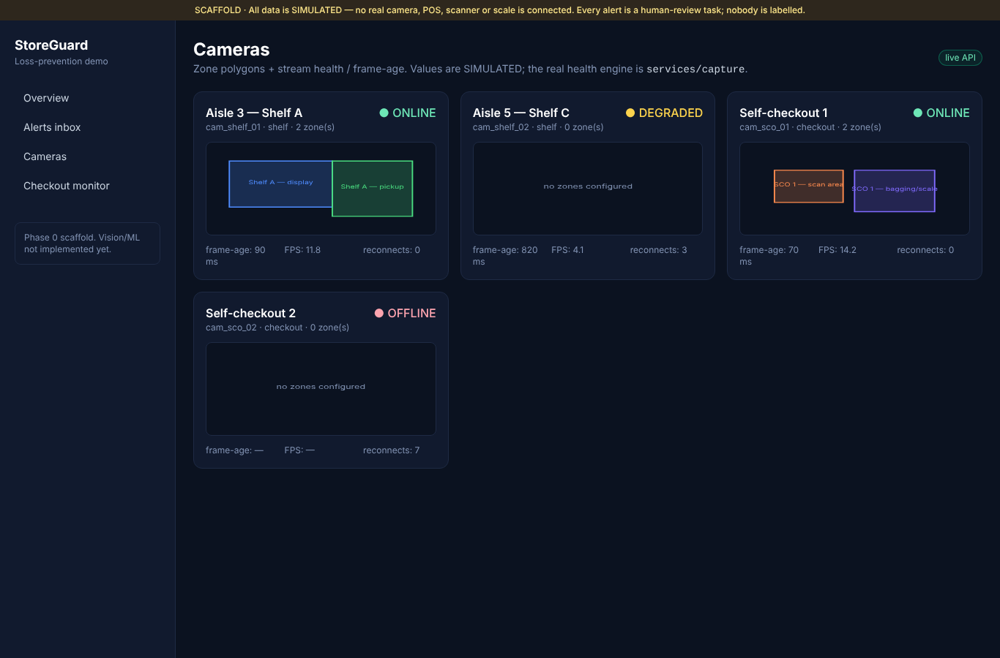

# StoreGuard — Phase 2 Report

> Camera supervision + polygon zones. Real supervision/health logic with a
> deterministic disconnect/reconnect test; zone geometry + overlay; dashboard
> shows zones and per-camera status. Honest scope: there is **no real RTSP
> camera** here, so the RTSP code path exists but reconnect/health is validated
> against a deterministic in-process source. Awaiting review before Phase 3.

- **Branch:** `feat/storeguard-demo-foundation`
- **Phase 2 commit:** `0db3baac64a14473cd999cdb05adea6b2c496e0f`
  (this line was recorded in the immediately following commit)
- **Date:** 2026-10-30
- **Machine:** 4× Intel(R) Xeon(R) @ 2.10GHz.

## 1. What was built
### `services/capture` — supervised camera
- `SupervisedCamera(source_factory, camera_id, …)` — background capture thread;
  **bounded latest-frame buffer (maxlen=1)** so a slow consumer never backs up
  the reader; **health state** (ONLINE/DEGRADED/OFFLINE/UNKNOWN) from frame-age
  thresholds + connection state; **frame-age (ms)**, **FPS**, **`reconnect_count`**;
  reconnect with **exponential backoff**. `status()` → real `CameraStreamStatus`
  (`simulated=False`).
- `RtspFrameSource(url)` — OpenCV RTSP/file adapter (`ml` extra). URLs/credentials
  stay server-side, never exposed to clients. Not run against a live camera here.
- `storeguard_capture.testing.CameraController` — deterministic in-process source
  (connects while "up", raises while "down") for camera-free tests/demos.
- CLI: `python -m storeguard_capture.cli camera-demo`.

### `services/zones` — polygon geometry + overlay
- `point_in_polygon` (ray casting), `zones_containing`, `load_zones(yaml)` →
  `CameraZone` (reads `configs/zones.example.yaml`; normalized `[0,1]` polygons).
- `draw_zones(image, zones)` overlay (`ml` extra); CLI
  `python -m storeguard_zones.cli zones-demo`.

### Dashboard
`apps/web` Cameras page now renders **SVG zone polygons** (colour-coded by zone
type) and per-camera **health + frame-age + FPS + reconnects** from the status
endpoint (live, with SIMULATED fallback).

## 2. Acceptance criteria (roadmap §11, Phase 2)
| Criterion | Evidence |
|---|---|
| Disconnect/reconnect test | `services/capture/tests/test_supervisor.py::test_online_offline_reconnect_cycle` + the CLI timeline below |
| Per-camera latest-frame buffer (no unbounded queue) | `SupervisedCamera` keeps `maxlen=1`; `test_bounded_buffer_tracks_latest` |
| Frame-age metric | `frame_age_ms` in `health()`/`status()`; grows during outage (below) |
| Camera status + zones visible | Cameras page screenshot (zones + state/frame-age/FPS) |

## 3. Disconnect → reconnect timeline (actual CLI output)
`python -m storeguard_capture.cli camera-demo --fps 20`:

```
 t(s)  state       age_ms    fps reconnects
  0.2  ONLINE           7   14.0          0
  0.9  ONLINE           2   18.9          0
  1.2  ONLINE           8   19.1          0
--- inject outage ---
  1.4  OFFLINE        158   19.1          2
  1.8  OFFLINE        610   19.1          3
  2.4  OFFLINE       1212   19.1          4
  2.7  OFFLINE       1513   19.1          4
--- recover ---
  2.9  ONLINE          11    9.1          4
  3.9  ONLINE           8    9.8          4
```
ONLINE (frame-age ~2–8 ms) → outage → **OFFLINE** with frame-age climbing
(158 → 1513 ms) and `reconnect_count` rising as backoff retries fire → recovery
back to **ONLINE**. All real, measured; `status().simulated == False`.

## 4. Zone overlays (CLI output)
`python -m storeguard_zones.cli zones-demo`:




## 5. Dashboard — zones + status


Cameras with configured zones (Shelf A, SCO 1) show colour-coded polygons; each
tile shows health state, frame-age, FPS and reconnect count. Cameras without
zones show "no zones configured". The SIMULATED banner remains.

## 6. Verification (actual)
```
ruff   → All checks passed!
black  → 54 files left unchanged
mypy   → Success: no issues found in 43 source files
pytest → 40 passed, 1 warning   (33 prior + 7 new capture/zones; camera-free)
web    → tsc clean · next lint clean · next build OK (7 routes)
capture-demo / zones-demo → outputs above
```

## 7. Notes / honest scope
- **No real RTSP camera** in this environment. `RtspFrameSource` is the real
  OpenCV code path but is not exercised against a live stream; reconnect/health is
  validated deterministically with `CameraController` (no network). On target
  hardware, point `SupervisedCamera` at a real RTSP factory.
- Dashboard health remains **SIMULATED seed data**; the real health engine is
  `services/capture`. Wiring live camera workers into the API/dashboard runtime is
  a later phase (5/7).
- The `ml` extra (OpenCV) is needed only for `RtspFrameSource` and the zone
  overlay; supervision/health and zone geometry are pure and run in CI.
- Zones encode geometry only — no identity; track IDs stay ephemeral and
  camera-local (Phase 1).

## 8. Status
Phase 2 acceptance met: deterministic disconnect/reconnect test, a frame-age
metric that grows during outage, a bounded latest-frame buffer, and a dashboard
showing camera status + zones. **Stopping here and awaiting product-owner review
before Phase 3** (shelf event MVP).
