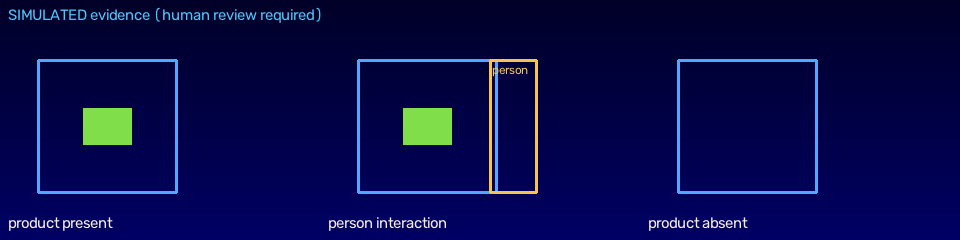

# StoreGuard — Phase 3 Report

> Shelf event MVP. A transparent finite-state machine turns per-shelf-zone
> occupancy observations into **observable** anomaly events (never an
> accusation), with occlusion/offline suppression and a controlled replenishment
> baseline update. Scenarios 1–3 pass deterministic replay tests and the
> false-alert count is recorded. Awaiting review before Phase 4.

- **Branch:** `feat/storeguard-demo-foundation`
- **Phase 3 commit:** `__PHASE3_SHA__`
- **Date:** 2026-10-30

## 1. What was built — `services/shelf-analytics`
- `ShelfMonitor` — a per-zone state machine implementing roadmap §4.A:
  - **A1 baseline**: established after N stable observations; updated only via
    approved replenishment or the stable-observation policy. A removal is **never**
    silently learned as a new baseline (asserted by test).
  - **A2 unresolved removal**: a product absent beyond `removal_interval_s`
    becomes `SHELF_ITEM_REMOVED_UNRESOLVED` **only** when the zone is not occluded
    and the camera is healthy; otherwise suppressed → `SHELF_OCCLUSION_REVIEW`
    with the zone marked UNKNOWN.
  - **A3 association**: a nearby person interaction is attached as supplementary
    association evidence (confidence components + ephemeral track ref), never
    identity; crowded/occluded → association UNKNOWN.
  - Cooldown de-duplication.
- `scenarios.py` — deterministic replay fixtures for the three roadmap scenarios
  and a recorded **false-alert count**.
- `evidence.py` — renders a short **evidence montage** (present → person
  interaction → absent) standing in for an evidence clip; returns an
  `EvidenceRef` (a real deployment serves an authenticated short-lived clip, never
  a raw path).
- `cli.py` — `shelf-demo` runs the scenarios, renders evidence, and walks the
  removal candidate through a **mock review** (acknowledge → resolve), the same
  lifecycle the API exposes.

All emitted events are the shared `AnomalyEvent` contract (human_review_required
= True, `simulated` = True here), so they flow through the existing API/dashboard
review endpoints unchanged.

## 2. Acceptance (roadmap §11, Phase 3)
| Criterion | Evidence |
|---|---|
| Shelf occupancy baseline + unresolved disappearance candidate | A1/A2 in `monitor.py`; `test_scenario_removal_fires_once_with_association` |
| Occlusion/offline suppression | `test_scenario_occlusion_no_removal_marks_unknown`, `test_offline_absence_is_unknown_not_removal` |
| Optional person/product association | `person_interaction_nearby` reason + track ref on the removal event |
| Evidence clip + review workflow | evidence montage below + `shelf-demo` mock acknowledge/resolve |
| Scenarios 1–3 pass replay tests | 6 passing tests in `services/shelf-analytics/tests` |
| False-alert count recorded | **0** across all scenarios (below) |

## 3. Scenario replay results (actual `shelf-demo` output)
```
=== Shelf scenarios (replay) ===
- shelf-removal          removal expected    removals=1 occlusion=0 false_alerts=0
      SHELF_ITEM_REMOVED_UNRESOLVED  sev=REVIEW   ['item_absent_over_threshold', 'person_interaction_nearby']
- shelf-occlusion        NO removal expected  removals=0 occlusion=1 false_alerts=0
      SHELF_OCCLUSION_REVIEW         sev=INFO     ['zone_occluded']
- shelf-replenishment    NO removal expected  removals=0 occlusion=0 false_alerts=0
TOTAL false alerts across scenarios: 0

=== Review workflow (mock) ===
acknowledge: evt_… -> ACKNOWLEDGED
resolve:     evt_… -> RESOLVED (CONFIRMED_OPERATIONAL_ANOMALY)
human_review_required stays: True
```

- **Scenario 1** (removal): visible → person interacts → absent beyond threshold →
  exactly **one** `SHELF_ITEM_REMOVED_UNRESOLVED` with person-association reason.
- **Scenario 2** (occlusion): shopper blocks the shelf → **no removal**;
  `SHELF_OCCLUSION_REVIEW`; zone UNKNOWN.
- **Scenario 3** (replenishment): approved restock → **no alert**; baseline updated.
- **False alerts: 0.**

## 4. Evidence montage (SIMULATED)


## 5. Verification (actual)
```
ruff   → All checks passed!
black  → 61 files left unchanged
mypy   → Success: no issues found in 49 source files
pytest → 46 passed, 1 warning   (40 prior + 6 new shelf scenarios/invariants)
shelf-demo → output above; evidence montage written
```

## 6. Notes / honest scope
- **Occupancy input is an observation**, not live SKU detection. In a full system
  `product_present` per zone is derived from the detector (Phase 1) + zone
  geometry (Phase 2); here it is provided directly so the rules are testable in
  replay without a lawful labelled retail dataset. Generic COCO weights do not
  recognize shelf SKUs.
- **Evidence** is a montage standing in for a clip; the `EvidenceRef` models the
  authenticated short-lived delivery a real deployment would use.
- The monitor emits events into the shared contract; wiring the live
  detector→zones→monitor pipeline and surfacing these in the dashboard is a later
  phase (5). No identity, no face recognition; track refs are ephemeral.
- Thresholds (`ShelfRules`) are conservative demo defaults; real tuning needs
  measured data (false alerts per camera-hour), per the roadmap evaluation plan.

## 7. Status
Phase 3 acceptance met: baseline + unresolved-removal candidate, occlusion/offline
suppression, optional person association, an evidence montage and review loop,
with scenarios 1–3 passing replay tests and a recorded false-alert count of **0**.
**Stopping here and awaiting product-owner review before Phase 4** (self-checkout
MVP: terminal state machine + simulated scanner/scale reconciliation).
