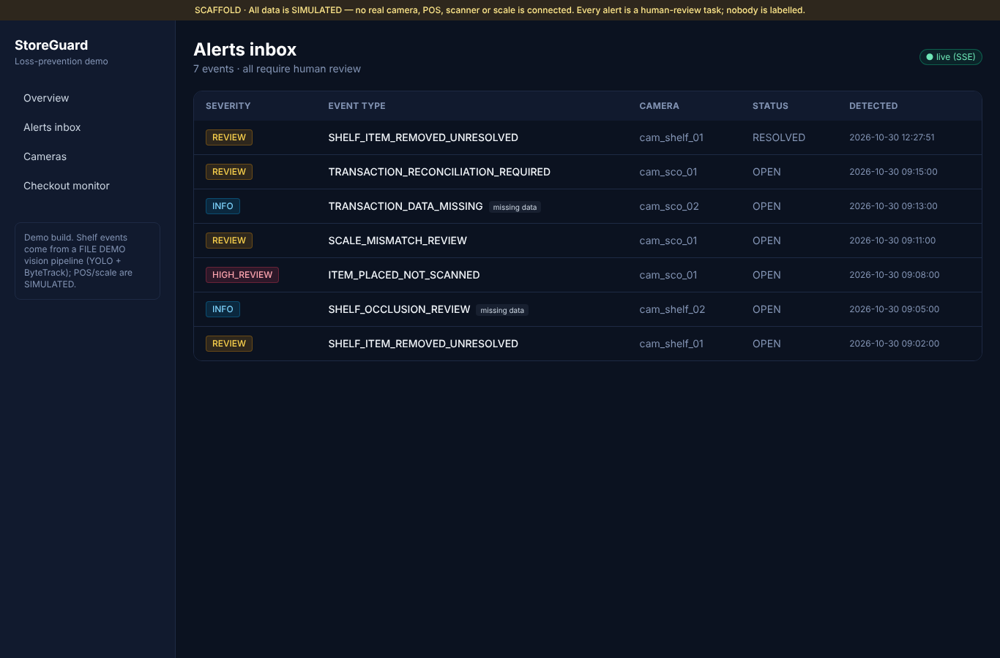
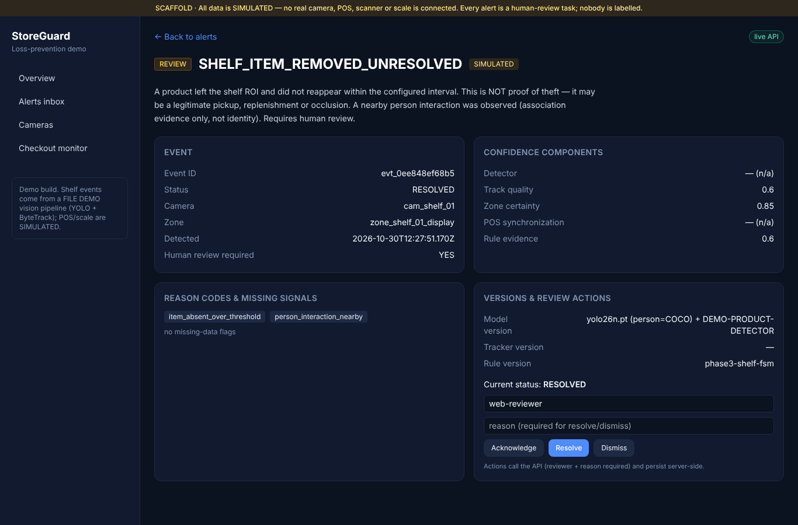
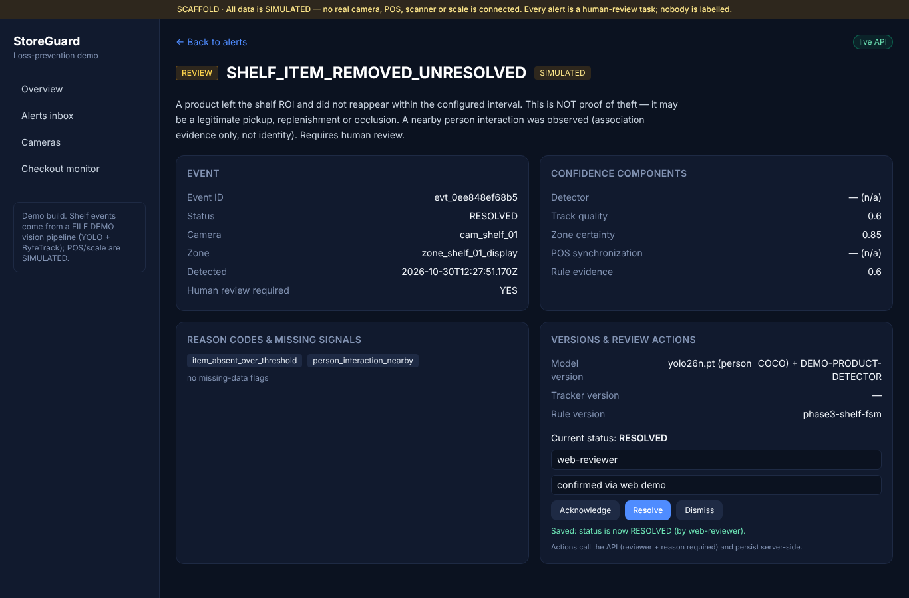
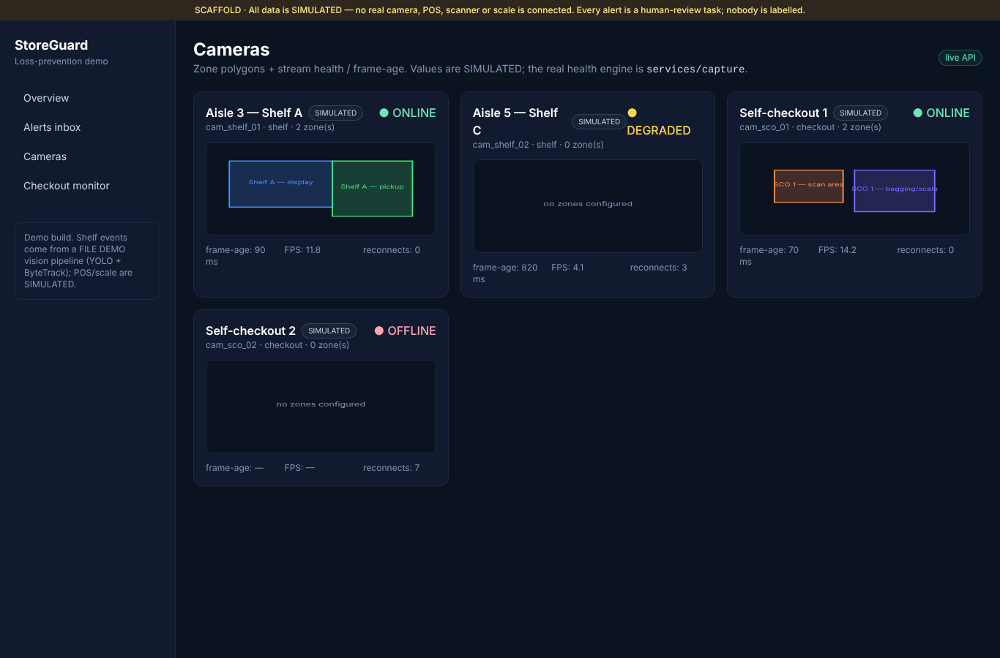

# StoreGuard — Repo Audit follow-up: P0 (CI) + P1 (vertical slice)

> Responds to `docs/REPO_AUDIT_AND_NEXT_WORK.md`. Scope of this run: **P0 and P1
> only**, then stop for owner review (per the execution contract). Branch
> `feat/storeguard-demo-foundation`; `main` untouched; no force-push.

- **Date:** 2026-10-30
- **Base:** audit commit `abc0432`
- **Commits (this run):** see §5.

---

## P0 — CI root cause + green baseline

### Root cause (established, with evidence)
Every CI run since the first Phase 0 push — **run_number 1 through 7** — failed
identically in **2–4 seconds**, with all three jobs (Backend/Web/Mobile)
completing as `failure` and **no step logs** (log download returns HTTP 404).

The decisive evidence is on the job object for the fresh run I triggered
(run #7, commit `7a9f883`): the Backend job reports

```
"runner_id": 0, "runner_name": "", "runner_group_id": 0, conclusion "failure", 2s
```

**No runner was ever assigned.** The workflow YAML is valid (3 named jobs are
created) and every CI command passes locally (below), so the steps never ran —
this is a **runner-provisioning / account-level block**, not a code or
workflow-step defect. On GitHub.com this signature means private-repo **Actions
minutes / spending-limit exhausted** (or a failed payment method), or **Actions
usage disabled** for the account/repo.

- Failing runs: <https://github.com/Ozgurisikdamar/Anomaly-Detection/actions/runs/41047025562> (audited) and `…/runs/41053742640` (fresh, after the workflow fix).

### What I can and cannot do
This is **owner-side** and cannot be fixed from the repository. Remedy for the
owner:
- Repo **Settings → Actions → General** — confirm Actions are enabled and
  workflow permissions allow runs: <https://github.com/Ozgurisikdamar/Anomaly-Detection/settings/actions>
- **Billing & plans** — check Actions minutes / increase the spending limit (for
  a private repo), or add/fix a payment method: <https://github.com/settings/billing>
- Or make the repository **public** — GitHub-hosted Actions are then free.

Once a runner is available, the workflow will go green (all commands pass
locally and the workflow is corrected below).

### Code-side actions taken
1. **Reproduced every CI command locally — all pass** (venv, this machine):
   ```
   ruff check            → All checks passed!
   black --check         → 78 files left unchanged
   mypy (9 src trees)    → Success: no issues found in 62 source files
   pytest (8 test dirs)  → 60 passed, 1 warning
   alembic upgrade head --sql (offline)  → OK
   web:  npm run lint / typecheck / build → OK (7 routes)
   mobile: tsc --noEmit / expo export --platform web → OK
   docker compose config → OK
   ```
2. **Hardened the workflow** (`.github/workflows/ci.yml`): added
   `workflow_dispatch`, `permissions: contents: read`, `concurrency`
   cancel-in-progress, and pip/npm dependency caching. Jobs/steps unchanged;
   pipeline test dir added.

**P0 status:** code + workflow are green-ready and proven locally; a green
Actions badge is **blocked on the owner-side runner/billing fix** above.

---

## P1 — Real vertical slice: file video → detect/track → zones → shelf FSM → API(DB) → web

### What was built
- **`services/pipeline`** — `PipelineCoordinator` composing, **per camera**, an
  isolated `YoloDetector` (real YOLO26n + ByteTrack; one instance per camera, so
  tracker `persist` state is never shared) → zone mapping
  (`storeguard_zones.point_in_polygon`) → per-camera `ShelfMonitor` → event
  publication. A `make_demo_clip()` generates a deterministic **FILE DEMO** shelf
  scene at runtime (no committed video).
  - **Honest product presence:** person interaction comes from the **real COCO
    `person`** detection; product occupancy comes from an explicitly labelled
    `DemoProductDetector` (a colour-marker stand-in) — **never** presented as SKU
    recognition. Emitted events carry
    `model_version = "yolo26n.pt (person=COCO) + DEMO-PRODUCT-DETECTOR"`.
- **API persistence** — `SqlAlchemyRepository` (events + review + **audit log**)
  behind the existing repository method surface; selected by
  `STOREGUARD_USE_IN_MEMORY_SEED=false` + `database_url`. The deterministic
  in-memory seed remains the default offline mode. Added `payload_json` column +
  migration update.
- **Realtime** — in-process `EventBus`, `POST /api/v1/events` ingest (persist +
  publish) and an **SSE** endpoint `GET /api/v1/stream/events` (no Kafka).
- **Web** — event-detail **Acknowledge / Resolve / Dismiss** wired to the API
  (reviewer + reason required, shows server response/errors); alerts inbox
  subscribes to **SSE** (live pill); camera tiles show a distinct
  **LIVE / FILE DEMO / SIMULATED** source badge.

### Acceptance — demonstrated end-to-end
One pipeline run ingested a real event into the DB-backed API; it appeared in the
web inbox; a reviewer resolved it in the browser; the decision survived an API
restart.

- Pipeline (API mode) measured metrics (CPU, FILE DEMO clip, 960×540):
  ```
  frames=24  detections=48  p50=71.93ms  p95=199.46ms  mean=150.99ms
  fps=6.62   cpu=184.5%(4 cores)  rss=821.8MB  detector=yolo26n.pt  source=FILE DEMO
  ```
- Event `evt_0ee848ef68b5` = `SHELF_ITEM_REMOVED_UNRESOLVED`, reasons
  `[item_absent_over_threshold, person_interaction_nearby]`, POST → `201`.
- Resolved from the **web UI** (reviewer `web-reviewer`, reason "confirmed via
  web demo") → status `RESOLVED`.
- **Restarted the API twice** (same database) → event still `RESOLVED`,
  decision `CONFIRMED_OPERATIONAL_ANOMALY`, audit row present. **Persistence
  proven.**

> **Persistence backend note (honest):** the Docker daemon is not available in
> this sandbox (`docker compose config` validates, but containers cannot run), so
> the restart-persistence proof used a **SQLite file** via the same engine-
> agnostic `SqlAlchemyRepository`. **PostgreSQL** is the configured target
> (`docker-compose.yml`, `make demo`, `psycopg` dependency) and runs the same
> code path unchanged on a host with Docker.

### Screenshots






### Tests added (60 pass total)
- `services/pipeline/tests` — FILE DEMO clip → event (guarded by the `ml` extra);
  per-camera detector isolation.
- `apps/api/tests/test_sql_repository.py` — resolve/audit persist across a fresh
  repo instance (restart proof) on SQLite.
- `apps/api/tests/test_ingest_db.py` — ingest → list → resolve persists via a
  DB-backed app; SSE route registered.

### One command
`make demo` brings up Postgres (compose), runs `alembic upgrade head`, starts the
API in DB mode, and runs the FILE DEMO pipeline against it. (In this sandbox,
substitute `STOREGUARD_DATABASE_URL=sqlite:///…/demo.db` as shown above since
Docker is unavailable.)

## Test matrix (audit §7) — covered so far
| Test | Status |
|---|---|
| File clip pipeline → event | ✅ pipeline test + live demo |
| Two camera sources: isolated tracker state | ✅ per-camera `YoloDetector` + test |
| Shelf removal → one dedup event | ✅ (Phase 3 + pipeline) |
| Shelf occlusion / offline → no removal | ✅ (Phase 3) |
| Approved replenishment → no anomaly | ✅ (Phase 3) |
| API review action persists | ✅ SQL repo + restart proof |
| Web review succeeds/fails visibly | ✅ screenshot |
| Camera disconnect/reconnect, frame age | ✅ (Phase 2 supervisor) |
| Checkout scenarios | ✅ replay (Phase 4); visual correlation is **P2** |
| Mobile review parity | ⏳ **P3** |
| Evidence as authenticated expiring URL | ⏳ **P3** (current: evidence image ref) |

## Limitations / honest scope
- **CI green is owner-blocked** (runner/billing), see P0.
- **No real RTSP camera** exercised; FILE DEMO is the validated path (RTSP code
  exists, server-side secrets).
- **Product presence is a labelled demo detector**, not SKU recognition; person
  detection is real COCO. No labelled retail dataset, so no accuracy claims.
- Persistence demonstrated on **SQLite** here (Docker unavailable); Postgres is
  the configured target and uses the same code.
- Metrics are from **one machine / FILE DEMO** at 960×540; not a retail-camera
  benchmark (that is P4).
- Mobile app unchanged (still the Phase 0/2 scaffold) — mobile API/realtime is
  **P3**.
- Reviewer identity is a mock field (`web-reviewer`) for the demo; real auth is a
  later hardening item.

## Status
P0 code-side complete (green locally; Actions blocked owner-side with documented
remedy). P1 vertical slice complete and demonstrated end-to-end with persistence.
**Stopping for owner review before P2** (checkout visual/event correlation), per
the execution contract.
