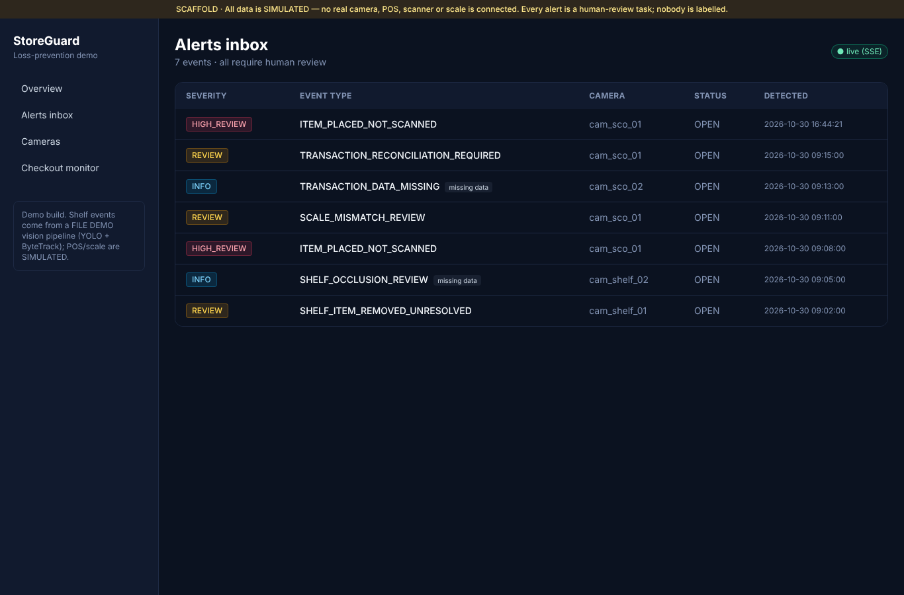
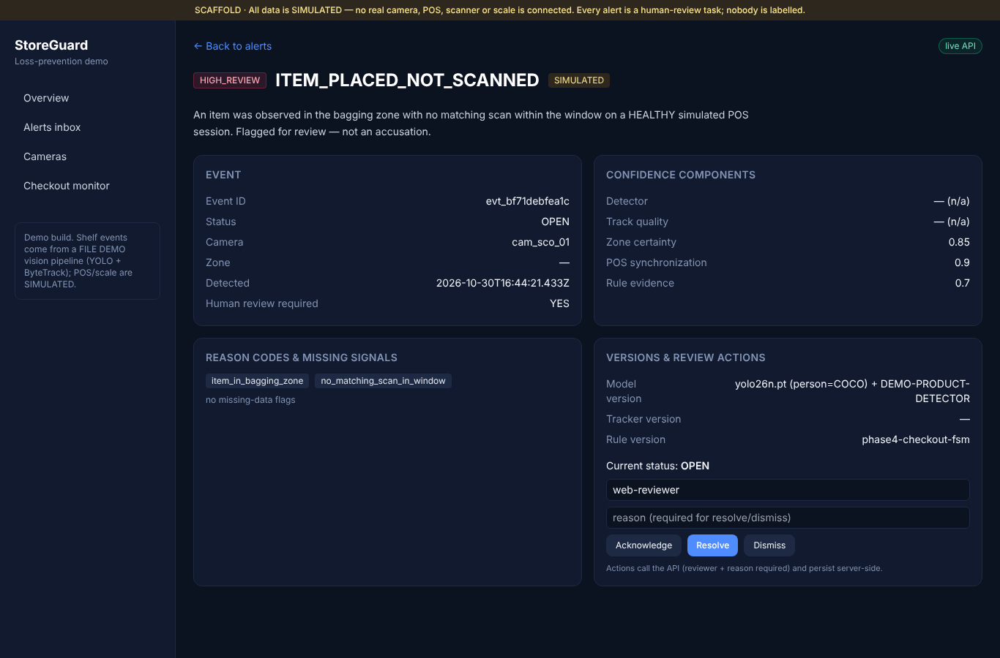
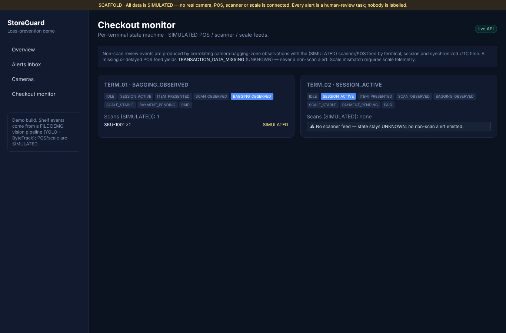

# StoreGuard — Repo Audit follow-up: P2 (checkout visual/event correlation)

> Responds to `docs/REPO_AUDIT_AND_NEXT_WORK.md` §P2. Scope of this run: **P2
> only**, then stop for owner review (per the execution contract). Branch
> `feat/storeguard-demo-foundation`; `main` untouched; no force-push. Builds on
> the approved P0+P1 work (`docs/reports/REPO_AUDIT_AND_PHASE_5_REPORT.md`).

- **Date:** 2026-10-30
- **Base:** `aab0ede` (origin/feat HEAD at start; P1 report commit)
- **Commits (this run):**
  - `95e65f3` feat(checkout): feed lateness, attendant override, session reset
  - `57e4bab` feat(integrations): PosFeed adapter interface + SimulatedPosFeed
  - `17d483a` feat(pipeline): checkout FILE DEMO clip + POS correlation coordinator + CLI
  - `2f2a300` test(checkout): delayed/override/multi-item/reset scenarios + correlation + safety metric
  - _(this commit)_ feat(web)+docs: checkout correlation note + this report + README status

---

## What P2 adds

The phase-4 checkout FSM already enforced the core safety rule (an unmatched
bagging item is a non-scan **only** on a healthy feed, else data-missing),
already refused scale mismatch without telemetry, and already handled voids.
P2 closes the remaining gaps and wires a real file→camera→correlation path.

### 1. FSM: lateness, attendant override, session reset
`services/checkout-analytics/.../model.py`, `monitor.py`
- `CheckoutRules.feed_lateness_window_s` (default 5.0) and
  `TerminalState.feed_degraded`. The `advance()` decision is now gated by
  `_feed_healthy(ts)` = *available AND camera OK AND not degraded*. A late feed
  (`set_feed_degraded`) is treated exactly like a down feed: an unmatched item
  resolves to `TRANSACTION_DATA_MISSING`, **never** `ITEM_PLACED_NOT_SCANNED`.
  The data-missing reason distinguishes `scanner_feed_unavailable` from
  `scanner_feed_delayed` for integration triage.
- `attendant_override` transaction kind resolves the matching item like an
  authorized void (no alert). Contract `TransactionEvent.kind` doc updated.
- `reset_session()` flushes an abandoned session (unresolved items reconcile to
  `TRANSACTION_RECONCILIATION_REQUIRED` / UNKNOWN — never a non-scan) then clears
  state, so a prior session cannot leak a false alert into the next one.

### 2. POS feed adapter interface (future real integration)
`services/integrations/.../pos_feed.py`
- `PosFeed` Protocol — `available(now)`, `degraded(now)`, `drain(now)` — that a
  real POS/scanner/scale integration implements behind the **shared contract
  types**. `validate_message()` enforces the correlation keys (`terminal_id`,
  `session_id`, `occurred_at`) so a malformed real adapter fails loudly.
- `SimulatedPosFeed`: scripted, time-stamped timeline with per-message delivery
  delay; `available=False` models a down feed, `degraded_window` models a
  delivery-lag outage. Every message stays `simulated=True`.

### 3. Checkout camera observation + correlation
`services/pipeline/.../checkout_coordinator.py`, `demo_clip.py`, `cli.py`
- `make_checkout_demo_clip()` renders a FILE DEMO self-checkout scene: a colour
  product marker **placed in the bagging ROI** (`zone_sco_01_bag`), read by the
  labelled `DemoProductDetector` — **never an SKU claim** — plus a real person so
  COCO YOLO + ByteTrack actually fire.
- `CheckoutPipelineCoordinator`: one **isolated** YOLO detector per camera; a
  rising-edge "product now in bagging ROI" is one `observe_bagging_item`; the
  `PosFeed` is drained on the session clock and **correlated by terminal_id +
  session_id + synchronized UTC time**. A down feed → `set_scanner_available`;
  a late/degraded feed (or a drained message whose lateness exceeds the window)
  → `set_feed_degraded`. Real-frame evidence attached; metrics recorded.
- CLI `checkout-pipeline-demo --feed {healthy,missing,delayed} --api-base`; posts
  produced events to the API ingest endpoint (→ web via SSE). Exits non-zero if a
  non-scan ever appears on an unhealthy feed.

### 4. Web + one-command demo
- `apps/web/.../checkouts/page.tsx`: a note that non-scan events come from
  camera↔POS correlation and that a missing **or** delayed feed yields UNKNOWN,
  never a non-scan. The event itself already renders in the SSE alerts inbox and
  detail (no AnomalyEvent rendering change needed).
- `make demo-checkout` runs the checkout slice against the DB-mode API.

---

## Acceptance — demonstrated end-to-end

API started in DB mode (`persistence: sqlite`; see honest note below). Pipeline
run (real YOLO26n, FILE DEMO checkout clip 960×540):

```
checkout-pipeline-demo --feed healthy --api-base http://localhost:8000
  metrics: frames=24 detections=64 p50=65.55ms p95=160.04ms mean=164.64ms
           fps=6.07 cpu=244.3% rss=809.4MB detector=yolo26n.pt source=FILE DEMO
  events produced: 1 (ITEM_PLACED_NOT_SCANNED=1)
    ITEM_PLACED_NOT_SCANNED  reasons=[item_in_bagging_zone, no_matching_scan_in_window]
  POST evt_bf71debfea1c -> 201
```

- The event appears in the **web alerts inbox** (live SSE pill) and its **detail
  page** (HIGH_REVIEW, SIMULATED, `cam_sco_01`, model
  `yolo26n.pt (person=COCO) + DEMO-PRODUCT-DETECTOR`, working review actions).
- **Restarted the API** on the same database → the event is still present
  (7 events total), persistence proven (reuses the P1 SQL path).

**Safety rule — a missing or delayed POS feed cannot create a non-scan alert:**

```
--feed missing  -> 1 event, ITEM_PLACED_NOT_SCANNED=0, TRANSACTION_DATA_MISSING (scanner_feed_unavailable)
--feed delayed  -> 1 event, ITEM_PLACED_NOT_SCANNED=0, TRANSACTION_DATA_MISSING (scanner_feed_delayed)
```

### Screenshots




---

## Tests added (74 pass total, was 60)
- `services/checkout-analytics/tests` — scenarios 9–12 (delayed feed, attendant
  override, multiple items, session reset) + `non_scan_on_unhealthy_feed` metric
  asserting **zero** non-scan across unavailable AND delayed feeds.
- `services/integrations/tests/test_pos_feed.py` — delivery timing/lateness,
  availability, degraded window, correlation keys, `validate_message`.
- `services/pipeline/tests/test_checkout_pipeline.py` (ml-guarded) — healthy →
  one non-scan; missing/delayed → zero non-scan; mismatched `session_id` never
  correlates.

## Test matrix (audit §7) — checkout rows
| Test | Status |
|---|---|
| Checkout scan + bagging + payment → no alert | ✅ scenario_normal |
| Bagging without scan + healthy POS → review alert | ✅ scenario_non_scan + live demo |
| Scanner feed unavailable → UNKNOWN, zero non-scan | ✅ scenario_feed_missing + `--feed missing` |
| Scanner feed delayed → UNKNOWN, zero non-scan | ✅ scenario_delayed_feed + `--feed delayed` |
| Scale feed absent → no scale mismatch | ✅ (`observe_scale` returns [] without telemetry) |
| Void / attendant override → no false non-scan | ✅ scenario_void + scenario_attendant_override |
| Multiple items (1 unscanned) → exactly one non-scan | ✅ scenario_multiple_items |
| Session reset → no non-scan leak | ✅ scenario_session_reset |
| Visual↔POS correlation by terminal/session/UTC | ✅ coordinator + pipeline test |

## Limitations / honest scope
- **POS/scanner/scale remain SIMULATED**; `PosFeed` is the seam a real
  integration plugs into. Video alone never asserts a scan.
- **Camera is FILE DEMO**; product presence is the labelled demo detector, not
  SKU recognition. Person detection is real COCO.
- Persistence demonstrated on **SQLite** (Docker unavailable in this sandbox);
  Postgres is the configured target and runs the same `SqlAlchemyRepository` code
  path. `make demo-checkout` uses compose Postgres on a host with Docker.
- Metrics are from **one machine / FILE DEMO** at 960×540; not a retail benchmark
  (that is P4).
- Reviewer identity is still a mock field; real auth is a later hardening item.
- CI green remains **owner-blocked** (runner/billing), unchanged from P0.

## Status
P2 complete and demonstrated end-to-end: a self-checkout FILE DEMO + SIMULATED
POS feed runs through the checkout FSM to an event visible in the web dashboard,
and a missing **or** delayed POS feed provably cannot create a non-scan alert.
**Stopping for owner review before P3** (real evidence clip + mobile
API/realtime), per the execution contract.
