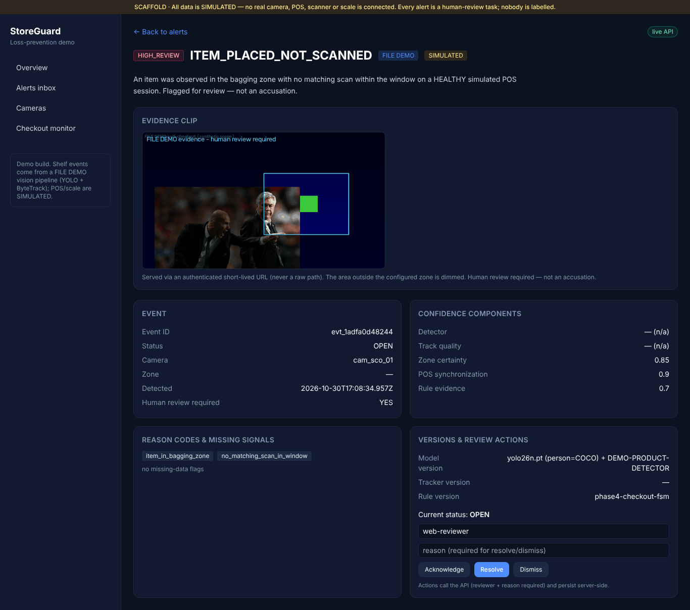
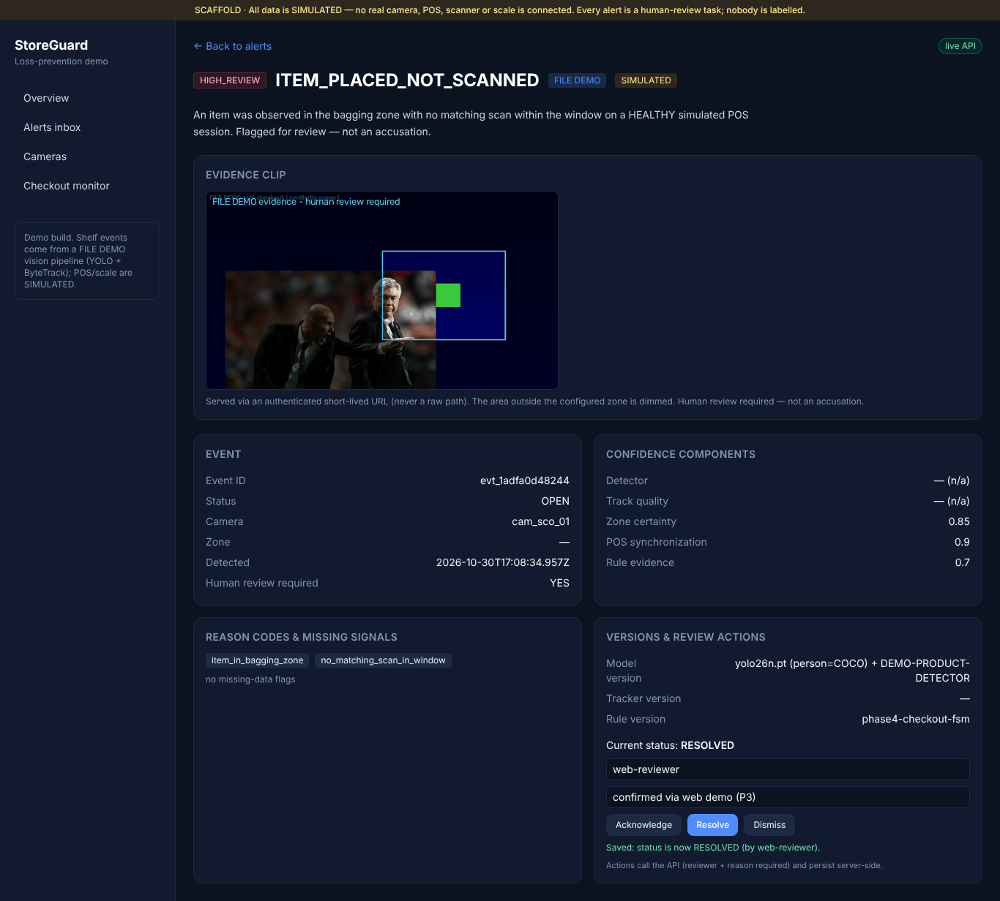
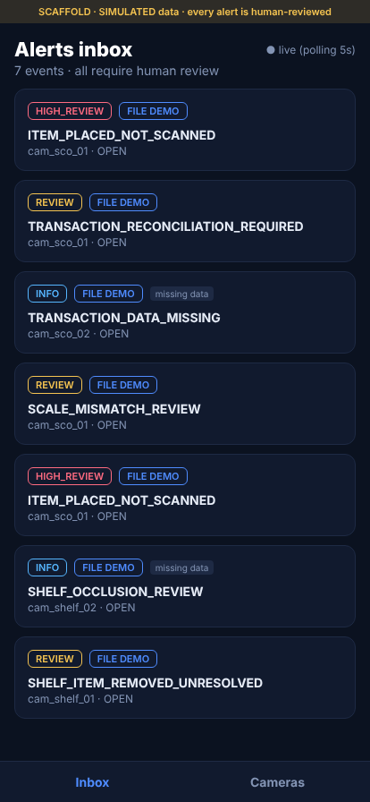
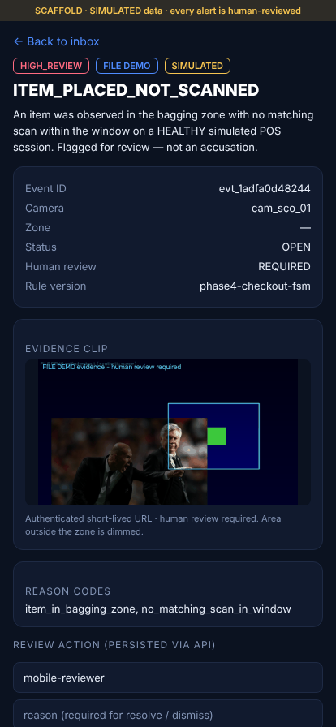
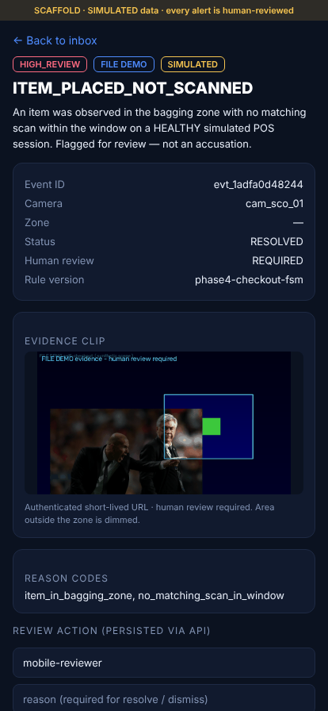

# StoreGuard — Repo Audit follow-up: P3 (evidence, review integrity, mobile)

> Responds to `docs/REPO_AUDIT_AND_NEXT_WORK.md` §P3. Scope of this run: **P3
> only**, then stop for owner review (per the execution contract). Branch
> `feat/storeguard-demo-foundation`; `main` untouched; no force-push. Builds on
> approved P0+P1 (`REPO_AUDIT_AND_PHASE_5_REPORT.md`) and P2
> (`REPO_AUDIT_P2_REPORT.md`).

- **Date:** 2026-10-30
- **Base:** `7020747` (P2 report commit)
- **Commits (this run):**
  - `b448ca1` feat(api): authenticated short-lived evidence URLs + server-authoritative review transitions
  - `7c7f177` feat(pipeline): real bounded zone-masked GIF evidence clip + upload to API
  - `c268929` feat(mobile): API review client, evidence clip, polling realtime, source labels
  - _(this commit)_ feat(web)+docs: evidence panel + per-event source label; P3 report; README; pipeline lint-width aligned to CI

---

## What P3 adds

### 1. Evidence — real clip, authenticated short-lived URL (no raw paths)
- `EvidenceRef` gains wire-only `url` + `expires_at` (Python contract + TS mirror); never a disk path,
  minted per read and expiring.
- `EvidenceStore` (`apps/api/.../evidence.py`) stores clips under a media root keyed by `evidence_id`
  and signs URLs with an HMAC secret: `GET /api/v1/evidence/{id}?exp&sig` returns the bytes only when
  the token verifies (**403** on bad/expired token, 404 if absent). `POST /api/v1/events/{id}/evidence`
  is the pipeline upload. `list`/`detail`/review responses carry a fresh signed `url`, and availability
  is recomputed from the store so it never over-claims.
- The pipeline builds a **bounded animated GIF** from the real pre/post frames
  (`services/pipeline/.../evidence_clip.py`), **dimming everything outside the configured zone**
  (privacy by design), and uploads it after posting the event. Replaces the old 2-panel PNG strip.
  Plays inline in a web `` and a React Native `<Image>` with zero extra client deps.

### 2. Server-authoritative, audited review transitions
- `apps/api/.../review.py` state machine: OPEN→{acknowledge,resolve,dismiss};
  ACKNOWLEDGED→{resolve,dismiss}; RESOLVED/DISMISSED terminal. Both repositories call
  `ensure_transition` before mutating; invalid/duplicate actions return **HTTP 409**; audit is written
  only on a successful transition. Web and mobile are equally constrained (both go through the API).

### 3. Mobile API client + realtime + evidence
- `apps/mobile/src/api.ts`: `fetchEvent(id)` + acknowledge/resolve/dismiss helpers (reviewer required;
  reason required for resolve/dismiss; resolve sends the decision), each returning a typed ok/error that
  surfaces the server reason (e.g. the 409). `sourceLabel()` → FILE DEMO vs SIMULATED.
- `EventDetailScreen` refetches by id (server-authoritative), renders the authenticated evidence GIF,
  and performs real review actions with reviewer/reason inputs + server status/error display.
- `InboxScreen`: in-app realtime via **5 s polling** + pull-to-refresh; per-event source tag.
- Physical-device **LAN** host guidance documented (localhost is the phone itself) in the mobile README
  and `.env.example`.

### 4. Web evidence playback + per-event source label
- The event detail page renders an **Evidence** panel (`` of the signed GIF, with the
  short-lived-URL / human-review note and an empty state) and a per-event FILE DEMO / SIMULATED label.

---

## Acceptance — demonstrated end-to-end

API in DB mode (`persistence: sqlite`; Postgres is the configured target, Docker unavailable here).
Pipeline run (real YOLO26n, FILE DEMO checkout clip 960×540) with evidence upload:

```
checkout-pipeline-demo --feed healthy --api-base http://localhost:8000
  metrics: frames=24 p50=79.69ms p95=118.6ms fps=6.4 cpu=186.8% rss=817.9MB detector=yolo26n.pt
  POST evt_1adfa0d48244 -> 201
  evidence ev_evt_1adfa0d48244 -> 201
GET /api/v1/events/evt_1adfa0d48244  -> evidence[0].url = /api/v1/evidence/ev_...?exp=...&sig=...
GET <signed url>                      -> 200 image/gif (420 KB animated clip)
GET <tampered sig>                    -> 403
```

- **Evidence plays in web** (detail Evidence panel) and **in mobile** (Expo web export, react-native-web,
  served against the live API) — zone-masked GIF in both.
- **Cross-client reflection + audit**: the event was **resolved from the web UI** (reviewer `web-reviewer`,
  reason); the **mobile** detail refetch then showed `Status: RESOLVED`; the SQLite audit log holds the
  row `web-reviewer / resolve:CONFIRMED_OPERATIONAL_ANOMALY / evt_1adfa0d48244` and the persisted status
  is `RESOLVED` (survives restart via the P1 SQL path).
- **Integrity**: a second resolve → **409**; acknowledge-after-resolve → **409**; an expired/tampered
  evidence URL → **403**.

### Screenshots






---

## Tests added (82 pass total, was 74)
- `apps/api/tests/test_evidence.py` — upload → signed-URL serve round-trip (200 bytes), bad signature →
  403, expired token → 403, unknown event → 404.
- `apps/api/tests/test_transitions.py` — happy ack→resolve; resolve-after-resolve → 409;
  ack-after-resolve → 409; dismiss-after-dismiss → 409.
- `services/pipeline/tests/test_pipeline.py` — asserts a real GIF clip is written keyed by evidence_id.

## Test matrix (audit §7) — P3 rows
| Test | Status |
|---|---|
| Web review succeeds/fails visibly | ✅ (P1) + 409 surfaced |
| Mobile review = same server-authoritative state as web | ✅ cross-client RESOLVED + audit |
| Evidence access: authenticated, expiring URL; no raw path/RTSP secret | ✅ HMAC token, 403 on expiry/tamper |
| Duplicate/invalid transition prevented | ✅ 409 (both repos) |

## Limitations / honest scope
- Evidence is an **animated GIF** built from FILE DEMO frames (a real bounded pre/post clip); not an MP4,
  and not a real-camera recording. Product presence is the labelled demo detector; person is real COCO.
- The evidence URL is signed with a **shared HMAC secret** (demo-grade): it protects the media link and
  expires, but it is **not** per-user authentication. `reviewer` remains a mock field. Real auth is a
  later hardening item; the secret must be set via `STOREGUARD_EVIDENCE_SECRET` in any real deployment.
- Mobile realtime is **polling** (5 s), not push; proven via the Expo **web export** (react-native-web)
  against the live API — no physical device was exercised in this sandbox.
- Persistence demonstrated on **SQLite** (Docker unavailable); Postgres is the configured target, same
  code path.
- CI green remains **owner-blocked** (runner/billing), unchanged from P0.

## Status
P3 complete and demonstrated end-to-end: a real zone-masked evidence clip plays in web and mobile via an
authenticated short-lived URL; a review action on one client is reflected on the other and audited;
invalid/duplicate transitions and expired/tampered evidence URLs are rejected. **Stopping for owner
review before P4** (real RTSP camera validation + OpenVINO benchmark), per the execution contract.
