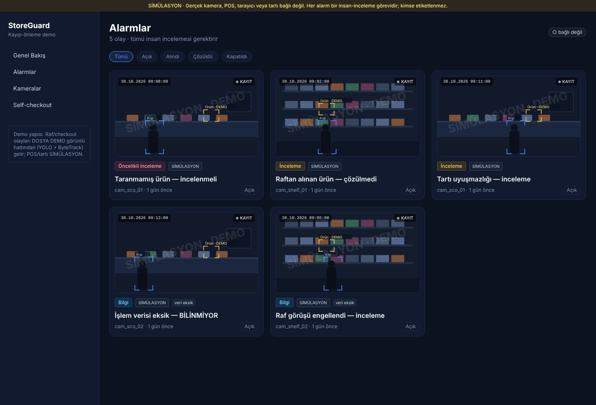
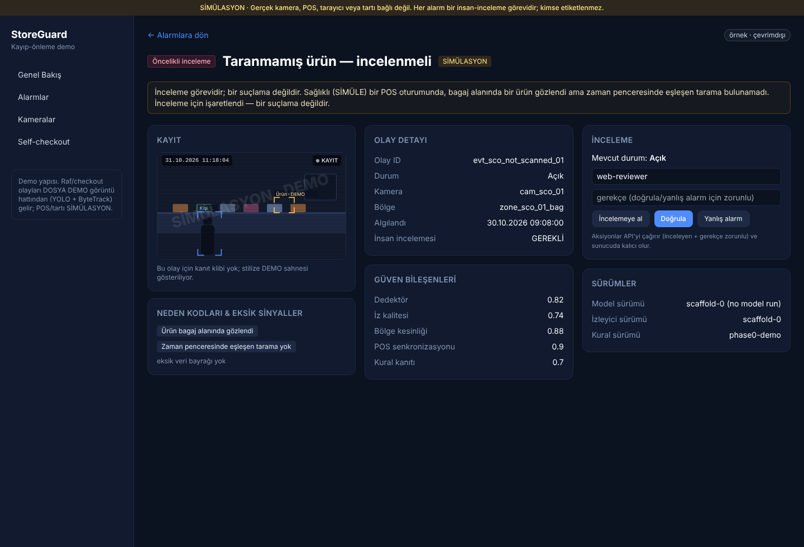
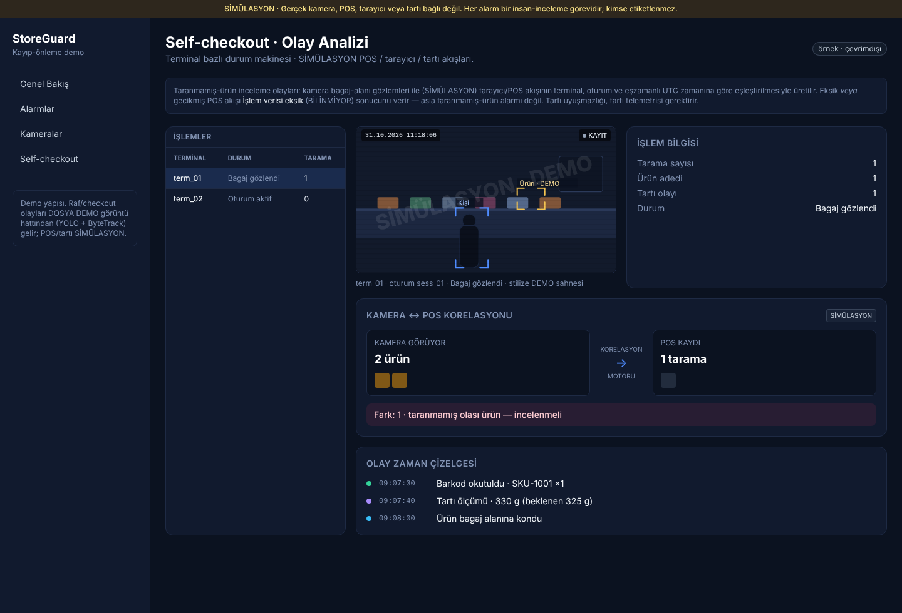
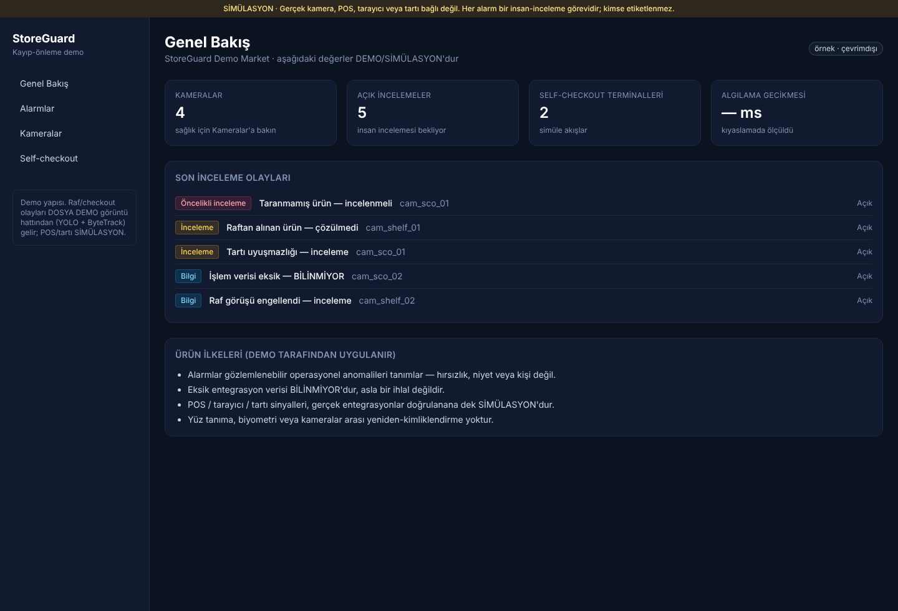
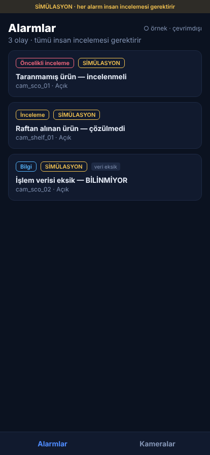
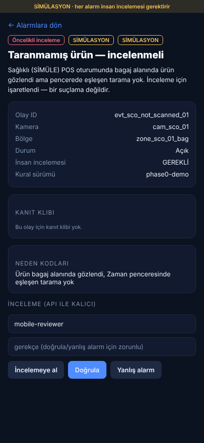

# StoreGuard — P5: Türkçe profesyonel kayıp-önleme konsolu (UI yeniden tasarım)

> Kullanıcının paylaştığı rakip ürün ekranlarından (Scylla, TRASSIR ActivePOS,
> Genetec, BLACKDOG, bir Kore self-checkout aracı) **ilham** alınarak — kopya
> değil — StoreGuard'ın tarafsız, insan-incelemeli diline ve koyu temasına uygun,
> **tamamen Türkçe** bir konsol. Görseller: repo içinde üretilen **stilize DEMO**
> CCTV sahneleri (SİMÜLASYON filigranlı); gerçek kanıt klibi varsa o gösterilir.

- **Tarih:** 2026-10-31 · **Dal/HEAD:** `main`
- **Commit'ler:** `c2b5500` (Türkçe sözlük + kabuk/genel bakış/kameralar) ·
  `126ec3d` (stilize CCTV sahnesi + alarm ızgarası + olay konsolu) ·
  `2087300` (self-checkout Olay Analizi + korelasyon + işlem tablosu) ·
  `2a3840b` (mobil Türkçeleştirme) · _(bu commit)_ rapor + görseller.

## Ne yapıldı
- **Türkçe katman** (`apps/web/src/lib/tr.ts`, `apps/mobile/src/tr.ts`): olay tipi,
  önem, durum, kamera durumu, bölge, neden kodu, karar ve **tarafsız açıklama
  şablonları** + tüm arayüz metinleri. Depolanan veri İngilizce kalır, görüntülenirken
  Türkçeye çevrilir (backend/testler değişmedi).
- **Stilize DEMO CCTV** (`components/CctvScene.tsx`): raf/self-checkout şematik
  sahnesi, bölge overlay'leri, köşe-ayraçlı kutular (**Kişi** / **Ürün · DEMO**),
  zaman damgası, CANLI/KAYIT çipi ve **SİMÜLASYON · DEMO** filigranı. Gerçek kanıt
  GIF'i varsa onu gösterir.
- **Alarm ızgarası** (`AlertsLive.tsx`): BLACKDOG tarzı kart ızgarası (CCTV küçük
  görsel + Türkçe etiket + önem/kaynak rozetleri + göreli zaman + durum) + durum
  filtreleri; SSE canlı akış korunur.
- **Olay detayı konsolu** (`alerts/[id]`): Scylla/TRASSIR tarzı 3 kolon — Kayıt ·
  Olay Detayı + Güven · İnceleme — tarafsız not ("İnceleme görevidir; bir suçlama
  değildir"); İncelemeye al / Doğrula / Yanlış alarm (API'ye bağlı).
- **Self-checkout Olay Analizi** (`CheckoutConsole.tsx`): seçilebilir işlem tablosu
  + CCTV + İşlem Bilgisi + **Olay Zaman Çizelgesi** (oturum olaylarından) +
  **Kamera↔POS Korelasyon şeridi** ("Kamera N ürün ↔ POS M tarama ↔ Fark K",
  tarafsız dil, SİMÜLASYON).
- **Mobil**: tüm ekranlar (giriş, gelen kutusu, olay detayı, kameralar) Türkçe;
  kaynak etiketi DOSYA DEMO / SİMÜLASYON.

## Ekran görüntüleri

## Doğrulama
- Web: `npm run lint` + `tsc --noEmit` + `next build` yeşil (7 route).
- Mobil: `tsc --noEmit` yeşil + `expo export --platform web` başarılı.
- Backend Python/testler değişmedi.

## Dürüstlük / sınırlar
- Görseller **stilize DEMO**'dur (foto-gerçekçi değil), açıkça SİMÜLASYON etiketli;
  görüntü üreten model yok, telifli/rakip görsel kullanılmadı.
- Dil **tarafsız**: gözlemlenebilir operasyonel anomali + insan incelemesi;
  "hırsızlık/şüpheli" gibi suçlayıcı etiket yok. KVKK/etik ilkeler korunur.
- POS/tartı hâlâ SİMÜLASYON; ürün varlığı etiketli demo dedektörü. Korelasyon
  şeridindeki sayılar oturumdan türetilen DEMO gösterimidir.
- Canlı veri için Netlify'da `NEXT_PUBLIC_API_BASE` + API'de
  `STOREGUARD_CORS_ORIGINS_EXTRA` gerekir (bkz. `docs/DEPLOYMENT.md`); aksi hâlde
  pano SİMÜLASYON örnek veriyle çalışır.
